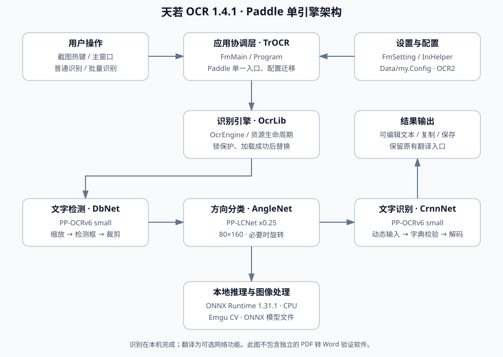

# tianruoocr-202610-local

天若 OCR 本地版 **1.4.2**：统一使用 Paddle 引擎，升级至 PP-OCRv6 small 检测与识别模型、ONNX Runtime 1.31.1，移除 CL 引擎及其菜单、设置和模型。当前精简版还移除旧 Paddle 备用模型、视频解码插件及未使用的依赖；详见 [精简说明](docs/发布说明-1.4.2.md)。

基于 [wangfreexx 的开源天若](https://github.com/wangfreexx/wangfreexx-tianruoocr-cl-paddle) 修改，遵循原项目 GPL-3.0 许可。本仓库保存天若桌面程序源码；PDF 转 Word 是独立验证项目。

原始项目发布页：[wangfreexx/wangfreexx-tianruoocr-cl-paddle/releases](https://github.com/wangfreexx/wangfreexx-tianruoocr-cl-paddle/releases)。本仓库为基于该项目修改的 Paddle 单引擎版本。

## 下载与使用

在 [发布页面](https://github.com/gukey/tianruoocr-202610-local/releases) 下载成品 ZIP，完整解压后运行 `天若OCR文字识别.exe`，不要直接在压缩包内运行。通过截图热键或主窗口识别，接口菜单只有“本地Paddle”。

需要 Windows x64、.NET Framework 4.7.2 或更高版本、Microsoft Visual C++ v14 x64 运行库。普通使用无需 Python 或 PaddlePaddle。当前验证环境为 Windows Server x64 / .NET Framework 4.8；Windows 10/11 全面兼容性测试尚未完成，不保证 Windows 7 兼容。

## 架构



详见 [架构与使用说明](docs/架构与使用说明.md)、[升级、验证与后续优化清单](升级与优化说明.md)。

## 构建

Windows 安装 .NET SDK 8 和上述运行环境，在仓库根目录运行：

```powershell
python tools/download_models.py
dotnet build tianruoocr-master/TrOCR.sln -c Release -p:Platform=x64
```

程序输出至 `tianruoocr-master/bin/x64/Release/net472`。模型已随源码提供；下载脚本可校验 SHA-256 并补齐缺失文件。NuGet 还原需要联网。构建产物、用户配置和凭据不纳入版本管理。

## 验证

```powershell
dotnet build tests/OcrSmoke/OcrSmoke.csproj -c Release -p:Platform=x64
./tests/OcrSmoke/bin/x64/Release/net472/OcrSmoke.exe tianruoocr-master/models/paddle-ocr-v6
dotnet build tests/PaddleOnlyUiSmoke/PaddleOnlyUiSmoke.csproj -c Release -p:Platform=x64
./tests/PaddleOnlyUiSmoke/bin/x64/Release/net472/PaddleOnlyUiSmoke.exe
```

测试覆盖实际 OCR、空白和倒置文字、资源释放、CL 配置迁移，以及 Paddle 设置保存和重载。合成样本回归不能代表真实文档准确率。
