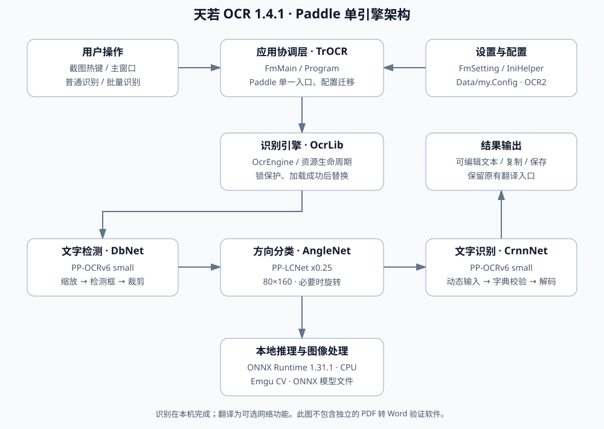
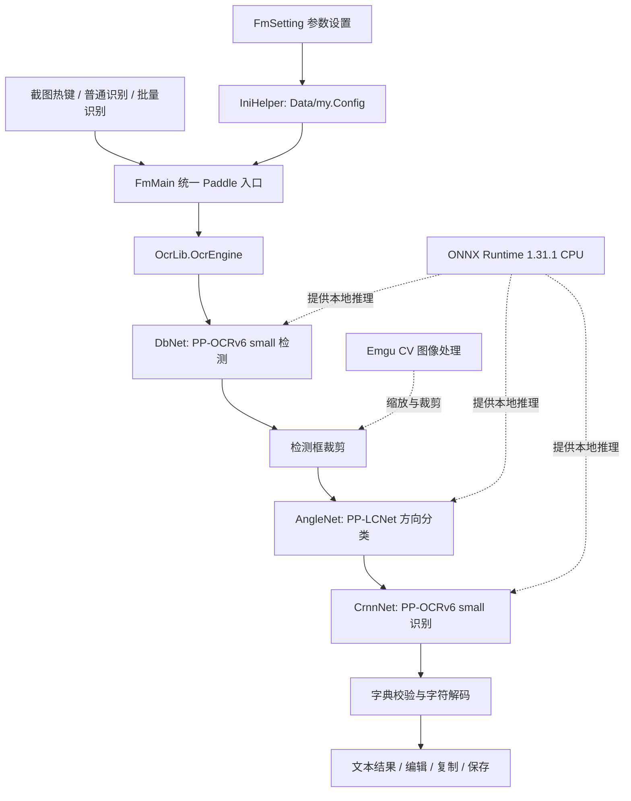

# 天若 OCR 1.4.1：架构与使用说明

本文对应 Paddle 单引擎版。内容区分已实现功能、已执行验证和待完成工作，维护日期为 2026-11-03。

## 一、版本范围

本软件是 Windows 桌面截图文字识别工具，保留原天若的截图、结果编辑、复制及翻译入口。普通截图和批量识别都调用本地 Paddle 管线。移除的 CL 是原项目另一套本地 OCR 引擎，不是命令行界面。

已删除 CL 工程引用、模型、菜单项、设置页以及识别分支；百度在线 OCR 密钥页也已移除。原项目仍有部分未启用的在线接口代码，尚未进行全面删除。翻译功能仍可能访问网络，离线 OCR 无需上传截图。

独立的 Paddle PDF 转 Word 验证软件不属于本仓库，不将其功能视为天若已实现能力。

## 二、总体架构

可编辑的流程描述：

图中的检测、分类、识别共用本地 ONNX 推理环境；真实执行由 OcrEngine 协调，图中箭头表示数据流。原生会话和图像对象需显式释放，不能只依赖托管垃圾回收。

## 三、源码目录

| 路径 | 作用 |
| --- | --- |
| `tianruoocr-master/TrOCR.sln` | 桌面解决方案入口 |
| `tianruoocr-master/FmMain.cs` | 主窗口与识别任务协调 |
| `tianruoocr-master/FmSetting.cs` | 设置读取、保存和模型切换 |
| `tianruoocr-master/Program.cs` | 启动、默认配置和旧配置兼容 |
| `tianruoocr-master/Helper` | 配置、截图及其他辅助功能 |
| `OcrLib` | 检测、方向分类、识别与推理资源管理 |
| `tianruoocr-master/models/paddle-ocr-v6` | 默认模型与配套字典 |
| `tianruoocr-master/models/paddle-ocr` | 兼容回退用旧 Paddle 模型 |
| `tianruoocr-master/DLL` | 上游截图等功能所需的预编译依赖和数据 |
| `tests/OcrSmoke` | 实际推理回归 |
| `tests/PaddleOnlyUiSmoke` | 主窗口、配置迁移和设置回归 |
| `tools/download_models.py` | 固定版本模型下载与 SHA-256 校验 |
| `Directory.Build.props / targets` | 公共构建设置和旧运行库清理 |

`DLL` 中的上游依赖为程序构建所需组件；它们不同于本机生成的 `bin/obj`。源码保留原项目依赖布局，尚未将所有第三方组件迁移至 NuGet。

## 四、识别流程与模型

1. 主窗口取得截图或批量图像，读取 Paddle 参数。
2. 检测阶段缩放图像并对齐模型尺寸，取得文本框和置信度。
3. 使用检测区域裁剪文本，避免逐框复制整幅图像。
4. 方向分类模型使用 80×160 输入，必要时旋转文本图。
5. 识别阶段根据模型元数据选择高度与宽度，对短行补零，运行识别网络。
6. 优先使用模型内置字符字典，并校验输出类别数量；不配套的字典会报错。
7. 返回文本至原有结果界面。

| 组件 | 当前默认版本 | 备注 |
| --- | --- | --- |
| 检测 | PP-OCRv6 small | `det_infer.onnx` |
| 识别 | PP-OCRv6 small | `rec_infer.onnx` |
| 方向分类 | PP-LCNet x0.25 | `cls_infer.onnx`，80×160 |
| 字典 | 配套 PP-OCRv6 字典 | `ppocr_keys.txt`，并检查模型元数据 |
| 推理 | ONNX Runtime 1.31.1 | CPU，托管与原生库配套 |

模型来自 RapidOCR 固定发布映射，文件哈希保存在下载脚本中。使用 ONNX 模型不要求安装 PaddleOCR Python 包。中文、英文、日文设置在新模型可用时使用同一套 v6 small 多语言模型；这不代表所有语言和版式均经过验证。

## 五、参数与配置迁移

用户配置位于程序目录下 `Data/my.Config`。升级前备份整个旧目录或此文件，推荐把新版本解压到独立目录，再复制配置。

- 旧接口为 CL 时，自动切换到 Paddle。
- 保留原有 Paddle 的 `OCR2` 配置节，避免丢失已有参数。
- 旧 CL 参数不再使用，新配置不再生成 CL 参数。
- 已修复 `boxThresh` 错写到 CL 字段的问题，Paddle 设置现可正确保存和重载。
- 修改模型时先创建新引擎，初始化成功后才替换旧引擎；失败时保留原引擎。
- 推理和模型替换通过锁同步，避免正在使用的会话被释放。

检测阈值与框阈值影响漏检、误检的取舍，最大边长影响小字效果、耗时和内存。线程数被限制在有效范围内。建议先使用默认值，再针对实际截图调整；尚无跨硬件统一推荐参数。

## 六、安装、构建与回退

从 Releases 下载成品，解压到有写入权限的目录，运行主程序。若本机尚无依赖，安装 .NET Framework 4.7.2/4.8 和微软 VC++ v14 x64 运行库。不要把旧目录中的 ONNX 或 VC++ DLL 覆盖进新目录。

源码构建命令见根目录 README。工程使用 SDK 风格，但目标仍是 .NET Framework 4.7.2，平台为 x64。构建自动清除旧 Emgu 附带的 VC++ 14.29 文件，避免其覆盖系统新版运行库造成 ONNX 初始化异常。

保留的旧 Paddle 模型可用于回退：关闭程序，将 `models/paddle-ocr-v6` 临时改名，再启动。此操作只切换模型，不会退回旧 ONNX Runtime。若需完整恢复旧运行环境，应使用原始发布包。

## 七、验证与适用边界

已有回归覆盖中英文和数字、倒置文字、空白图、零边距、连续推理一致性、模型缺失、重复释放与重载、无效线程参数、旧模型和错误字典拒绝。界面回归覆盖主窗口实际识别、CL 接口迁移、单 Paddle 菜单、设置读取和持久化。

验证环境为本机 Windows Server x64、.NET Framework 4.8 和 VC++ 14.50。未完成 Windows 10/11、多显示器 DPI、低配硬件、长期运行及全界面人工回归。未测得可发布的真实业务准确率或性能提升比例。旧模型运行时可能输出时间步元数据形状警告，相关回归仍需检查实际结果。

本工具输出识别文本，不提供文档结构重建能力。多栏阅读顺序、竖排、复杂表格、公式、低分辨率小字均需补充真实样本评估。

## 八、后续优化

| 优先级 | 工作 | 验收方向 |
| --- | --- | --- |
| 高 | UI 线程更新改为同步上下文或 BeginInvoke | 连续截图、关闭窗口时无跨线程异常 |
| 高 | 以协作取消替代 Thread.Abort | 取消、退出与原生推理资源清理可重复验证 |
| 中 | 检测框按行聚类和阅读顺序排序 | 多栏、中英混排、竖排样本集 |
| 中 | 评估强制 GC 和工作集裁剪 | 长时间识别的延迟、内存曲线 |
| 中 | 网络访问统一超时与取消 | 翻译断网、超时、用户取消 |
| 中 | 用户 API 配置使用 DPAPI | 配置迁移与本机解密验证 |
| 中 | 建立真实截图基准集 | 比较准确率、耗时和峰值内存 |
| 低 | 清理闲置在线接口和依赖 | 保持截图、翻译和识别回归通过 |

## 九、发布与许可

GitHub 仓库保存源码、模型、必要依赖和文档；成品 ZIP 放在 Releases，`bin/obj`、本机配置、访问凭据和调试缓存不提交。发布包应包含使用说明、许可及校验文件，并与发布标签对应的源码构建一致。

原项目采用 GPL-3.0，修改版继续保留其许可与来源。模型、ONNX Runtime、Emgu CV、ShareX 等组件分别遵循各自上游许可，分发时需一并遵守；根目录 GPL 不能替代第三方许可。
